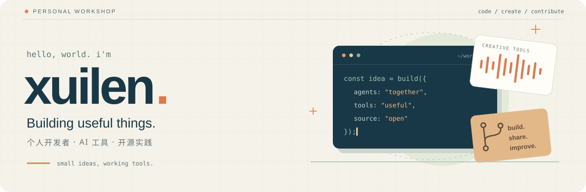

  

  <strong>把想法做成工具，把改进带回开源。</strong> 
  Personal tools. Creative workflows. Open-source contributions.

  <a href="https://github.com/xuilen/multiwork">multiwork</a> ·
  <a href="https://github.com/xuilen/OpenDot">OpenDot</a> ·
  <a href="https://github.com/xuilen/scenecraft">SceneCraft</a> ·
  <a href="https://github.com/xuilen/Multi-speaker-speech-synthesis">有声书工坊</a>

## 👋 关于我

你好，我是 **xuilen**。我喜欢把日常工作和创作中的想法做成能用的工具，最近主要在做 **AI 工作台、个人助手和创作工具**。

我的项目围绕两个问题展开：怎样让多个 Agent 更方便地一起工作，以及怎样让 AI 融入写作、配音这些具体流程。我在自己的仓库中持续改进产品，也向上游提交问题修复、测试和文档更新。

## 🧩 正在打磨的作品

<table>
  <tr>
    <td width="50%" valign="top">
      <h3>01 · multiwork</h3>
      
<strong>一个本地工作台，放下多个 AI Agent。</strong>

      
把原生 AI CLI 和模型 API 放进同一对话，支持并发回答、顺序协作与自动讨论，查看各自回复和可用的 Token 用量。

      
JavaScript · Electron · 本地优先 基于 Meldwork 维护的发行版；提供 Windows v1.1.0 预发布包。

      
<a href="https://github.com/xuilen/multiwork">查看源码 ↗</a> · <a href="https://xuilen.github.io/multiwork/">项目主页</a> · <a href="https://github.com/xuilen/multiwork/releases/tag/v1.1.0">下载</a>

    </td>
    <td width="50%" valign="top">
      <h3>02 · OpenDot</h3>
      
<strong>可以对话，也可以持续接受委托的助手。</strong>

      
可自托管的个人 AI 助手与团队工作台，在对话中查找工作区记忆、安排每周任务、查看进展并处理执行审批。

      
TypeScript · React · Node.js · SQLite 基于 OpenDot 源码快照持续改进，保留 Miniclaw contributors 署名。

      
<a href="https://github.com/xuilen/OpenDot">查看源码 ↗</a> · <a href="https://xuilen.github.io/OpenDot/">项目主页</a>

    </td>
  </tr>
  <tr>
    <td width="50%" valign="top">
      <h3>03 · 一幕成戏 SceneCraft</h3>
      
<strong>从一句话点子，到一场可以反复打磨的戏。</strong>

      
面向个人短剧创作者的单场戏工作台：选择冲突、生成初稿，对选中段落提出修改，比较后接受，支持撤销与稿件导出。

      
TypeScript · Next.js · React · Zustand 提供缓存示例；自定义创作需配置模型服务。

      
<a href="https://github.com/xuilen/scenecraft">查看源码与体验入口 ↗</a>

    </td>
    <td width="50%" valign="top">
      <h3>04 · 多角色有声书工坊</h3>
      
<strong>让小说中的不同角色，有各自的声音。</strong>

      
围绕中文 TXT / EPUB 小说，串联对白提取、角色与音色配置、TTS 合成和音频导出，提供网页工坊与命令行入口。

      
Python · JavaScript · LLM · TTS 项目名：Multi-speaker-speech-synthesis

      
<a href="https://github.com/xuilen/Multi-speaker-speech-synthesis">查看源码与使用说明 ↗</a>

    </td>
  </tr>
</table>

## 🔧 开源贡献

我也从具体问题入手参与上游维护：参数边界、跨平台测试、界面生命周期和文档一致性。

| 项目 | 已合并的改进 | PR |
| :--- | :--- | :--- |
| **DeerFlow** | Serply 搜索复用统一参数转换逻辑，处理布尔值、小数等输入边界 | [#7872](https://github.com/bytedance/deer-flow/pull/7872) |
| **DeerFlow** | 为文件读取测试固定 LF 换行，避免 Windows 换行转换影响断言 | [#6949](https://github.com/bytedance/deer-flow/pull/6949) |
| **Folio** | 清理流式 Markdown 测试挂载，防护定时器回调，修复测试环境销毁后的异常 | [#323](https://github.com/helsome/folio/pull/323) |
| **DeerFlow** | 同步中文 README 的功能说明与导航链接 | [#6947](https://github.com/bytedance/deer-flow/pull/6947) |

以上合并状态核验于 2026-11-19。<a href="https://github.com/search?q=is%3Apr+author%3Axuilen+is%3Amerged+-user%3Axuilen&amp;type=pullrequests">查看已合并贡献</a> · <a href="https://github.com/search?q=is%3Apr+author%3Axuilen+is%3Aopen+-user%3Axuilen&amp;type=pullrequests">查看进行中的 PR</a>

## 🛠️ 项目中使用的技术

`TypeScript` · `JavaScript` · `Python` · `React` · `Next.js` · `Node.js` · `Electron` · `SQLite`

近期关注：**Agent Runtime、Harness 工程、工作区记忆机制、MCP 协议、RAG 解析、多 Agent 协作、AI 创作流程**。

---

  欢迎试用、提 Issue，或者一起把工具打磨得更好。 
  Build something useful. Keep making it better.

